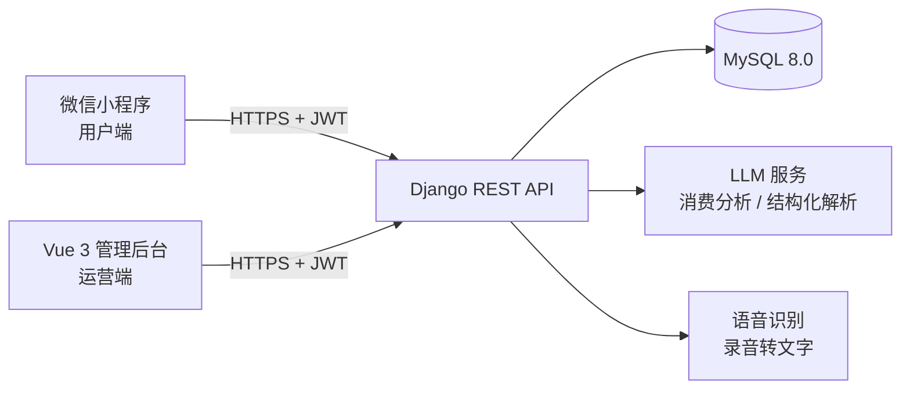

# 智能家庭记账系统 · Family Finance

一套面向家庭场景的记账应用，由 **微信小程序（用户端） + Django REST API（服务端） + Vue 3 管理后台（运营端）** 三端组成。

支持 AI 语音记账、家庭共享账本、多维统计可视化、借贷追踪、预算与周期账单管理。


---

## 预览

> 运行截图待补充：放入 `docs/screenshots/` 后取消下方注释即可。
> 建议截 6 张：首页、记账页（含语音）、统计页、AI 助手、管理后台看板、账单分享卡片。

<!--
| 首页 | 记账 | 统计 |
|---|---|---|
|  |  |  |

| AI 助手 | 管理后台 | 分享卡片 |
|---|---|---|
|  |  |  |
-->

---

## 功能特性

### 微信小程序（用户端）

| 模块 | 能力 |
|---|---|
| 记账 | 文字智能记账（输入「午饭 35」自动识别金额/分类/日期）、**语音记账**、二级分类、6 种支付方式 |
| 账单 | 列表筛选（日期 / 分类 / 关键词）、编辑、左滑删除、下拉刷新 + 触底加载 |
| 统计 | 日 / 周 / 月 / 年四维切换，环形图 + 柱状图 + 趋势条（原生 Canvas 绘制），成员贡献对比，Canvas 生成分享卡片 |
| 家庭 | 邀请码加入家庭、全家 / 个人视图一键切换、成员数据隔离 |
| 借贷 | 借出 / 借入、状态流转（待还 → 部分还 → 已结清 / 逾期）、还款记录 |
| 管理 | 钱包余额、月度预算（支持复制上月）、周期账单自动生成、金额隐藏 |

### Vue 3 管理后台（运营端）

数据看板、用户管理、账单管理、分类维护、权限控制（路由守卫 + 角色判断）。

---

## 技术栈

| 端 | 技术选型 |
|---|---|
| 小程序 | 微信小程序原生框架、Canvas 2D 图表、`RecorderManager` 录音 |
| 后端 | Django 4.2 + Django REST Framework 3.14、SimpleJWT、MySQL 8.0（兼容 SQLite）、PyMySQL、python-dotenv |
| 管理后台 | Vue 3.4 + Vite 5、Element Plus、ECharts 5、Pinia、Vue Router 4、Axios |
| AI 能力 | OpenAI 兼容接口的 LLM（DeepSeek）、RAG 式账单数据上下文、Whisper 语音转写 |

---

## 系统架构



后端按 `models / serializers / services / views` 四层划分，业务逻辑集中在 `services/`，视图层只做参数校验与响应封装。

---

## 目录结构

```
.
├── family_finance/              # 后端（Django + DRF）
│   ├── config/                  # 项目配置（settings / urls / wsgi）
│   ├── finance/                 # 核心应用
│   │   ├── models.py            # 数据模型（用户 / 账单 / 预算 / 家庭 / 借贷…）
│   │   ├── serializers/         # 序列化器
│   │   ├── services/            # 业务逻辑（AI / 语音 / 统计）
│   │   ├── views/               # 接口视图（15 个模块）
│   │   └── migrations/          # 数据库迁移（9 个版本）
│   ├── scripts/                 # 建库脚本 / 初始化数据
│   └── requirements.txt
├── family_finance_admin/        # 管理后台（Vue 3 + Vite）
│   └── src/
│       ├── api/                 # Axios 封装
│       ├── layouts/             # 布局
│       ├── router/              # 路由 + 守卫
│       ├── stores/              # Pinia 状态
│       └── views/               # 页面（登录 / 看板 / 用户 / 账单 / 分类…）
└── miniprogram/                 # 微信小程序
    ├── components/              # chart-box（Canvas 图表）、voice-input（语音输入）
    ├── pages/                   # home / record / stats / ai / mine / loan / login
    └── utils/                   # api / request / voice
```

---

## 快速开始

### 1. 后端

```bash
cd family_finance

# 建库（MySQL）
mysql -u root -p < scripts/create_mysql_db.sql

# 配置环境变量
cp .env.example .env          # Windows: copy .env.example .env
# 编辑 .env，至少填写 DB_PASSWORD；想用 AI 功能再填 LLM_API_KEY

# 安装依赖并启动
python -m venv venv
venv\Scripts\activate         # macOS/Linux: source venv/bin/activate
pip install -r requirements.txt
python manage.py migrate
python scripts/init_data.py   # 初始化演示数据
python manage.py runserver 0.0.0.0:8000
```

健康检查：<http://127.0.0.1:8000/api/health/>

> 未配置 MySQL 时，可在 `.env` 中设置 `DB_ENGINE=sqlite` 改用 SQLite 跑通流程。

### 2. 管理后台

```bash
cd family_finance_admin
npm install
npm run dev
```

### 3. 微信小程序

1. 用**微信开发者工具**导入 `miniprogram/` 目录，AppID 可选测试号；
2. 「详情 → 本地设置」勾选 **不校验合法域名**；
3. 真机调试时，将 `app.js` 中的 `apiBase` 改为电脑局域网 IP（如 `http://192.168.1.10:8000/api`），并确保手机与电脑同一 WiFi。

### 演示账号

| 账号 | 密码 | 角色 |
|---|---|---|
| `admin` | `admin123` | 管理员 |
| `zhangsan` | `123456` | 普通成员 |

> 以上为 `scripts/init_data.py` 生成的本地演示账号，部署到公网前请务必修改或删除。

---

## 技术亮点

1. **语音记账链路**：小程序录音 → 上传后端 → ASR 转文字 → LLM 结构化解析为「金额 + 分类 + 备注」→ 回填表单，全流程无需手工输入。
2. **RAG 式消费助手**：将当前用户的真实账单按时间维度聚合后作为上下文注入 Prompt，让 AI 回答基于真实数据，而非泛泛而谈。
3. **数据隔离的家庭账本**：以家庭为单位的数据可见性控制，同一用户可在「全家 / 个人」两种视图间切换，接口层统一收口权限校验。
4. **前端零依赖图表**：统计页的环形图、柱状图、趋势条全部用原生 Canvas 2D 手写，不引入第三方图表库，控制小程序包体积。
5. **配置安全**：`SECRET_KEY`、数据库密码、LLM / ASR 密钥全部从环境变量读取，`.env` 不纳入版本控制。

---

## 已知限制与后续计划

- [ ] 账单数据导出（Excel / CSV）
- [ ] 多币种与汇率换算
- [ ] 单元测试覆盖（当前以手工测试为主）
- [ ] Docker Compose 一键启动（MySQL + 后端 + 后台）

---

## 作者

**董秋杏** — 软件工程技术专业

本项目为课程设计作品，涵盖需求分析、数据库设计、三端开发与联调部署全流程。
